# PhiPhysiceEditorNeo

PhiPhysiceEditorNeo 是一个自包含的 2D **多边形物理音符编辑器**。原件保存在 `components/` 文件夹中，按物理块、场景块、力场分为三个子文件夹；每个原件都是独立的 `.note` 文本文件，记录名称、节点、材质、颜色或力场参数。编辑器提供 Tap、Drag、Flick、Hold 四种音符，使用内置的刚体引擎在画布上摆放、连接和模拟音符。

项目使用 C++20、raylib 和自研物理引擎构建，界面为自绘控件；音符与工程都是纯文本，程序目录可以整体拷贝。

**当前版本：1.0.0** · Windows 10/11 x64 / x86 · 中文界面 · MIT 许可

## 下载

发布包分为两个架构，内容相同，都是解压即用的绿色版：

| 文件 | 适用系统 | 说明 |
| --- | --- | --- |
| `PhiPhysiceEditorNeo_v1.0.0_windows-x64.zip` | 64 位 Windows 10/11 | 推荐，绝大多数电脑使用这个 |
| `PhiPhysiceEditorNeo_v1.0.0_windows-x86.zip` | 32 位 Windows 10/11 | 旧电脑或 32 位系统 |

下载后解压到任意目录，双击 `PhiPhysiceEditorNeo.exe` 即可运行。程序目录可以放在中文路径下，不需要安装，也不会写入注册表。同一目录下的 `components/`、`assets/`、`projects/` 是程序数据，请勿删除。

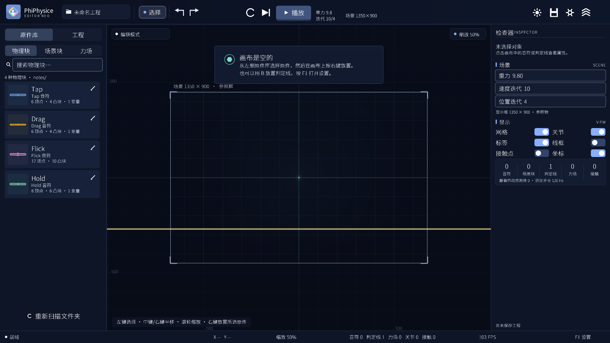

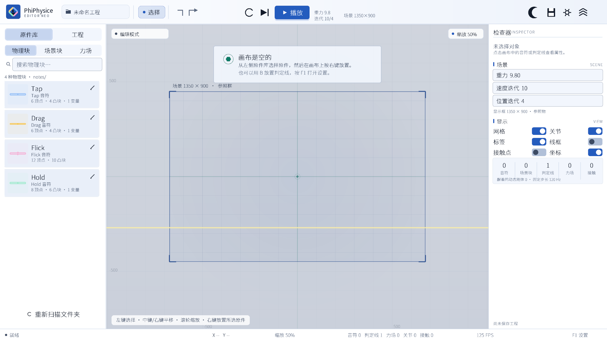

## 功能

- **文件化原件**：`components/physics/`、`components/scene/` 和 `components/fields/` 分别保存物理块、场景块和力场。物理块与场景块的 `.note` 文件保存名称、节点、密度、摩擦、弹性、颜色、变量和节点绑定；力场的 `.note` 文件保存类型、形状、默认尺寸、强度和涡流强度。程序不再内置或写入 note 节点默认值，节点始终以文件内容为准；启动和载入只读取文件，不会自动覆盖或改写现有 `.note`。
- **四种音符**：Tap、Drag、Flick、Hold 在物理块和场景块文件夹中各自拥有独立的节点文件；文件的节点定义保持原样。
- **变量与节点绑定**：`&名称 显示名 = 默认值` 声明类型变量，`$节点编号 X表达式 Y表达式` 用表达式覆盖节点坐标，表达式里的 `this` 表示该节点在文件中的默认坐标；需要偏移时写 `this + 变量`。选中音符后可在检查器中单独修改当前音符的变量值，并随工程保存。
- **原点与重心分离**：变量和节点绑定只移动顶点，不改写音符原点；物理刚体以轮廓的面积质心作为重心并绕其旋转。Hold 的原点在底部，`height` 只让 0 / 5 / 6 / 7 节点向上移动，因此加高时重心自然落在加长后形状的中部，而底部原点保持不动。
- **每个音符独立重力方向**：检查器提供 3 × 3 重力方向选择，包含上、下、左、右、左上、右上、左下、右下和无。默认向下；选择“无”时该音符不受重力影响。物理块中的普通音符和物理铆钉都可单独设置；多选它们时检查器也会显示同一组重力按钮，可一次统一所选物理原件的方向（混合选择中的场景块会被忽略）。场景块与场景铆钉固定在世界中，不显示该选项。每个选择独立保存。
- **预制事件导出**：点击顶部栏保存按钮旁的导出图标，在弹窗中填写切分和结束时间 beats。按 1/切分 beat 采样物理块与场景块中的 Tap / Drag / Flick / Hold，逐个原件输出全部采样，再输出下一个原件；每个采样输出 X、Y、角度、beats。结果写入 `NotePhysics.json`，UTF-8、每次覆盖。输出完全由程序目录的 `export_rules.txt` 决定，程序不再内置输出模板；可在其中编辑前置、后置、原件之间、参数之间和每个参数的文本模板。当前随程序提供的规则按 RePhiEditor 的 `note3d.json` 结构编写。
- **撤销 / 重做**：最多 80 步，支持按钮与快捷键。
- **日间 / 夜间模式**：切换立即生效，并保留到下次启动。夜间模式使用与日间模式等大的月牙切换图标。
- **八种马卡龙主题色**：蓝色、粉色、绿色、黄色、橙色、天蓝色、紫色、灰色，在设置的“外观”页切换，并保留到下次启动。每个按钮是沿 45° 直径分成深色 / 浅色两半的圆形。黄色减少红色、橙色增加红色，两者明显区分。
- **设置窗口**：顶部齿轮按钮打开；未进入放置状态且未选中对象时按 `Esc` 也可打开。包含“基础”“外观”“快捷键”“预制事件”四个页面。基础页包含显示开关、重力、速度迭代、位置迭代和缓步模拟滑动杆；外观页只显示主题色圆形按钮和色名；预制事件页可设置导出目录。
- **自定义快捷键**：点击键位按钮后按下新的按键组合即可绑定；设置写入 `settings.ini`，下次启动自动载入。重复绑定会给出提示。
- **按住退格连续删除**：所有文本输入框和数值输入框支持按住 `Backspace` 快速删除。
- **放置预览**：按 `2` 放置时的跟随鼠标预览会正确三角化凹多边形（例如 Flick），不会跨过缺口填充。
- **暂停时背景变暗**：暂停只压暗画布背景（网格与场景框），音符、判定线与力场保持原色，状态与操作提示保持清晰。
- **通知位置**：右下角消息提示已移到左下角，避开检查器和底部状态栏。
- **16:9 自适应界面**：程序以 1600 × 900（16:9）窗口启动，界面随窗口等比缩放；画布默认缩放为 50%。Windows 构建使用 GUI 子系统，启动时不再弹出命令行窗口。
- **原件库分区与搜索**：左侧“原件库”分为物理块、场景块、力场三个分区；物理块列出 Tap/Drag/Flick/Hold 与铆钉，场景块列出场景块、场景铆钉和判定线，力场分区列出六种矩形力场卡片。顶部的搜索框对所有分区生效，可过滤物理块、场景块、铆钉、判定线与力场。未进入放置模式时卡片不会显示选中高亮。
- **数字键放置**：`1` / `3` 在当前分区内部切换上一个 / 下一个原件（物理块、场景块或力场），`2` 在画布鼠标位置放置；三个键都可以在设置中重新绑定。左键仍用于选择、框选和拖动，放置预览跟随原件自身的颜色，并持续跟随鼠标显示提示文字与切换/放置快捷键。
- **判定线**：默认 4000 × 5 px、淡黄色；在“场景块”中选中后按放置键（`2`）或 `B` 进入放置，可拖动、输入角度/尺寸/颜色、删除，并作为静态刚体参与碰撞。放置预览按当前判定线的宽度、高度与角度绘制。
- **场景块**：场景块分区提供 Tap、Drag、Flick、Hold 四种场景块，顶点来自 `components/scene/` 中各自的 `.note` 文件；放置后是静态刚体，固定在世界中（包括 Hold），只参与碰撞。场景块带有半透明白色填充/粗描边。判定线排列在四种场景块之后。
- **虚化**：物理块和场景块中的 Tap / Drag / Flick / Hold 以及判定线都可在检查器开启“虚化”，默认关闭。开启后音符半透明、判定线颜色不变但改为虚线，并且不再产生任何物理碰撞；其余外观、选择与编辑行为保持不变。多选音符时检查器提供“全部虚化 / 恢复实体”批量操作，混合选择中的物理块和场景块会一起修改，铆钉保持原样。
- **WASD / 多选旋转 / 复制**：选中对象后 `W` / `A` / `S` / `D` 连续移动坐标；多选音符按 `Q` / `E` 时以选中音符中心整体旋转；在音符上按住 `Ctrl` 左键拖动会复制相同属性并立即拖动副本。
- **铆钉原件与铰链**：原件库的物理块和场景块分区各自提供一个独立的“铆钉”原件；放置后默认是灰色半透明带边框圆点，不参与任何碰撞，物理铆钉受重力、场景铆钉固定在世界中并额外带半透明白色粗线填充。物理铆钉可在检查器中像音符一样设置 3 × 3 重力方向，也支持重力方向事件。铆钉半径在原件库底部统一设置，所有铆钉共享；颜色仍可在检查器中单独编辑。铆钉不会被附加到普通音符上。选中音符和铆钉后按“铰链”即可建立连接；铰链显示为灰色虚线和两端半径 5 的描边圆点，右键可在音符范围内拖动端点（世界锚点为黄色端点）。移动带铰链的物件后会自动重建铰链位置；铰链带有相对角速度阻尼，摆动会逐渐衰减并停下。
- **六种力场**：引力场、斥力场、浮力场、阻力场、引力改变场和涡流场。原件库只提供矩形放置卡片（默认 100 × 100），放置后可在检查器中改为圆形（半径 50）。引力场向中心、斥力场向外施加越靠近中心越强的力；浮力场按阿基米德公式产生真实浮力；阻力场削减经过音符的线速度与角速度但不施加动力；引力改变场把经过音符的重力方向改为箭头方向；涡流场施加绕中心旋转的切向力，正强度顺时针、负强度逆时针。力场固定在世界中，可单独设置尺寸、最大强度、方向、流体密度和阻尼。引力场绿色、斥力场红色、浮力场蓝色直线边框、阻力场灰色、引力改变场黄色、涡流场紫色，均带透明填充和边框；涡流场还会画出沿切向的箭头网格。
- **引力场阻尼**：引力场检查器可开启“阻尼”，按强度持续削减场内音符的动量。阻力场同样只削减动量，不施加方向力。
- **真实浮力**：浮力场不再使用“额外动力 + 底部阻力”的模拟方式，而是按真实公式计算：`F = 流体密度 × 排水面积 × 重力`。程序把每个音符的凸块与力场体积裁剪，累加实际排水面积并取排水区域的形心，因此部分覆盖的音符会同时获得升力和旋转；流体密度大于音符密度时上浮，小于时下沉。检查器提供“流体密度”和“浮力角度”（默认与重力相反）。流体阻力按 `Fd = 0.5 × 流体密度 × Cd × 排水面积 × |v| × v` 叠加低速黏性项，不再使用过大的固定阻尼。
- **缓步模拟挡位**：设置在“基础”页以滑动杆调节，范围为 0 / 5 / 10 / … / 50。挡位写入 `settings.ini`，下次启动恢复。
- **角度约定**：旋转角度默认 `0`，正数顺时针、负数逆时针；浮力/引力方向等方向类角度以 `0` 为正上方。音符、判定线和力场的旋转角度不再归一化，可以保存和输入大于 360° 或小于 0° 的连续角度。
- **BPM 与 beats**：设置“基础”页可输入 BPM（默认 180，保存到 `settings.ini`）；播放时状态条同时显示毫秒和 `beats = 毫秒 / (1000 / (BPM / 60))`。
- **事件时间轴**：选中音符、铆钉、判定线或力场后点击“编辑事件”打开。每个元件有 10 条从左到右排列的竖直轨道，时间轴从下到上；切分数可在事件界面调整（默认 4，即 1/4 beat）。按 `Q` / `E` / `R` 在鼠标位置放置事件起点，再次按下放置终点并生成事件，放置过程中显示完整虚影。左键拖动事件可同时改时间和轨道，`Z` + 左键拖动起点、`Z` + 右键拖动终点。事件参数包括类型、起止 beat、起始值/结束值表达式、缓动编号（1–28，直接输入编号修改）和“瞬时完成”开关，底部显示缓动曲线。事件区域支持左键框选和 Shift / Ctrl 多选；拖动任一选中事件可整体移动，Z+左键 / 右键可整体改起点 / 终点；Ctrl+C / X / V 复制、剪切并按鼠标位置粘贴，粘贴前显示虚影；“复制到其他原件”会打开覆盖式选择界面，相机缩放和位置与当前视图一致，只能平移 / 缩放视窗和选择原件；选好目标后点击“确认复制”才会复制，目标支持同类型事件时沿用原轨道，轨道位置被占用则改用相邻轨道。物理块中的普通音符和物理铆钉额外提供“重力方向”事件类型，取值 0–8，与工程文件里的重力方向编号一致（0 上、1 下、2 左、3 右、4 左上、5 右上、6 左下、7 右下、8 无），插值后取最近的方向；它们还提供“方位动量”施加事件，普通音符另外提供“旋转动量”施加事件。方位动量会沿额外角度表达式给出的方向施加总动量（0 为正上方、正数顺时针），角度的 `this` 是音符当前角度；旋转动量正数顺时针。涡流场额外提供“涡流强度”事件，正数顺时针、负数逆时针。两种动量在持续时间内分摊总动量，开启“瞬时完成”后改为在起点一次施加。Tap / Drag / Flick / Hold 和判定线还提供“虚化”事件，结束值 1 开启虚化、0 恢复实体；虚化事件固定为瞬时完成，在起始 beat 立即生效。所有事件开启“瞬时完成”后都会忽略时长和缓动，在起点直接到达结束状态。表达式可用 `this`（事件开始时该参数的当前值；方位动量的角度为音符当前角度）、`pi`、`t`（0..1 进度）和 `et`（缓动后的进度）。事件结束后不再控制物理块，保留结束时的数值。
- **场景显示框**：画布上叠加 1350 × 900 的参照框，用半透明遮罩区分场景内外；它只作为参照物，不进入物理世界。
- **默认空白场景**：程序启动时没有音符，只在 (0, -270) 放置一条判定线；新建工程同样如此。
- **形状编辑器**：拖动顶点、双击空白添加顶点、数值调整顶点、设置材质/颜色；保存后写入对应的 `components/physics/<名称>.note` 或 `components/scene/<名称>.note`。任意简单多边形都可使用，物理侧自动拆分为凸块。
- **物理引擎**：凸多边形碰撞、SAT + 边裁剪接触流形、顺序冲量求解、热启动、摩擦/弹性、休眠、扫掠宽相；支持铰链、两点焊接和世界锚点。凸形音符整体参与碰撞，凹形音符按凸块分解并对内部边接触做过滤，减少静止时的抖动。
- **编辑**：放置（`2` / 可自定义）、框选、Shift 多选、拖动、WASD 移动、Ctrl+拖动复制、旋转、删除、视野聚焦；网格/关节/标签/线框/接触点/坐标显示已移到设置的“基础”页。`Esc` 依次退出放置、取消选中，空闲时打开设置。
- **工程**：应用内新建 / 保存 / 另存为 / 打开 / 删除；保存编辑布局、重力、求解迭代次数、每个音符的属性、所有力场及其阻尼、引力方向和涡流强度。模拟中的位置不写入工程。
- **画面**：直接绘制到高 DPI 原生帧缓冲，启用 4× MSAA；鼠标坐标按 DPI 与帧缓冲缩放映射。
- **字体**：界面字体按需从随程序分发的 `PhiPhysiceNeoSans-Regular.ttf` 生成字形图集，字体文件中的绝大部分中文字符（包括 `.note` 变量显示名中的生僻字）都可以直接显示；字形以旧版 2 倍的基准分辨率栅格化，再按绘制字号采样，小字更清晰。图集按页分配，只缓存实际绘制过的字符。字体是 Noto Sans SC 的 Regular 静态实例，已按 SIL OFL 1.1 重命名并保留完整版权说明，详见 [字体说明](assets/fonts/NOTICE.md)。
- **自检**：`--selftest` 覆盖多边形、Hold 几何、变量表达式、音符/工程格式迁移、刚体落地、堆叠、凹多边形、铰链、焊接、每个音符的重力、力场动力学、设置读写和工程读写。
- **发布信息**：Windows 资源包含作者/发布者 `Abnormalily`，并嵌入 asInvoker 清单，避免启动时因自动提权出现“无法验证发布者”的 UAC 提示。
- **跨平台**：CMake + raylib + `std::filesystem`，Windows / Linux / macOS 均可构建。

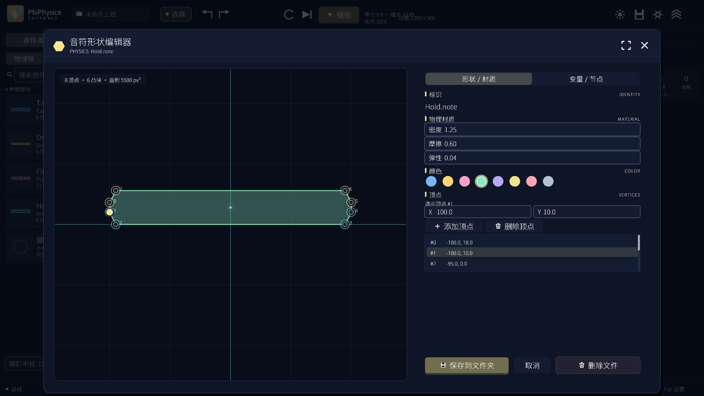

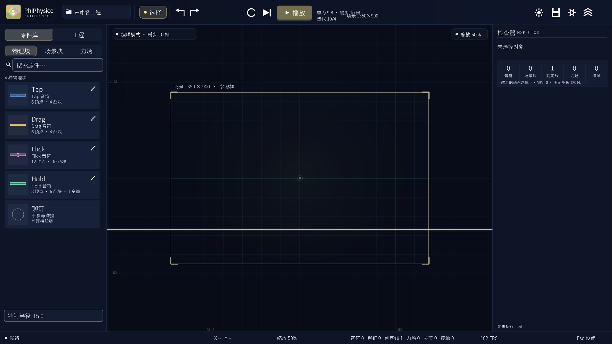

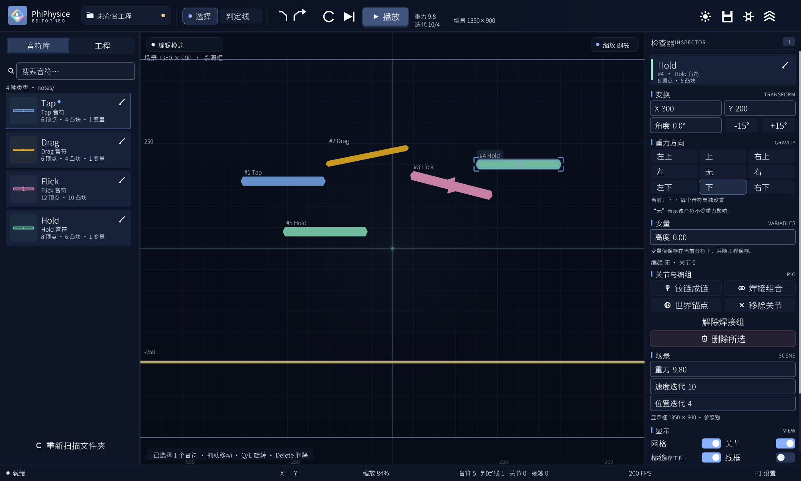

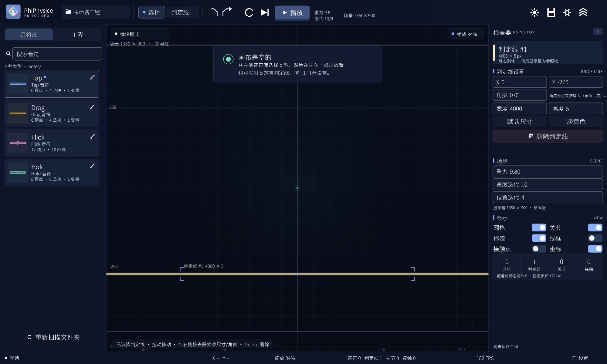

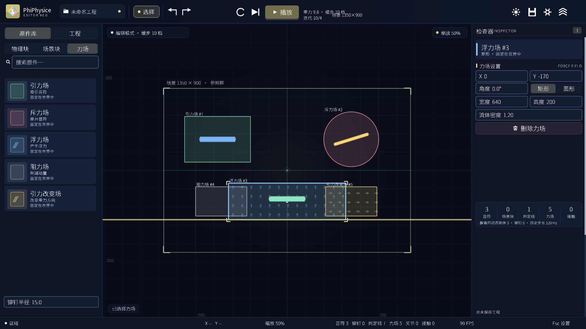

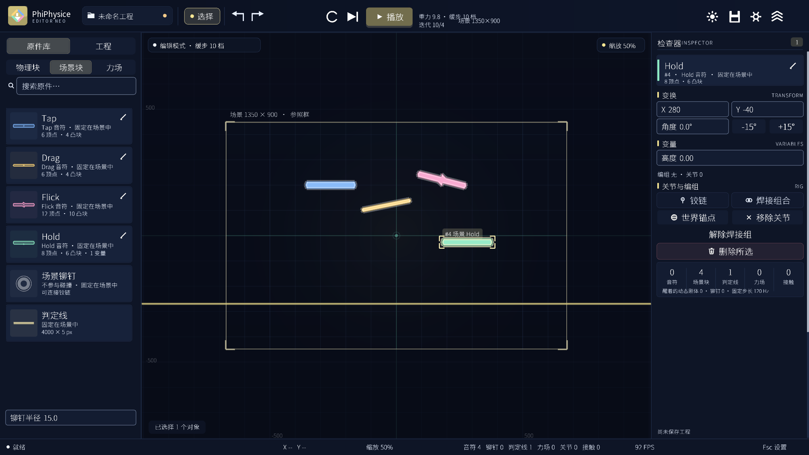

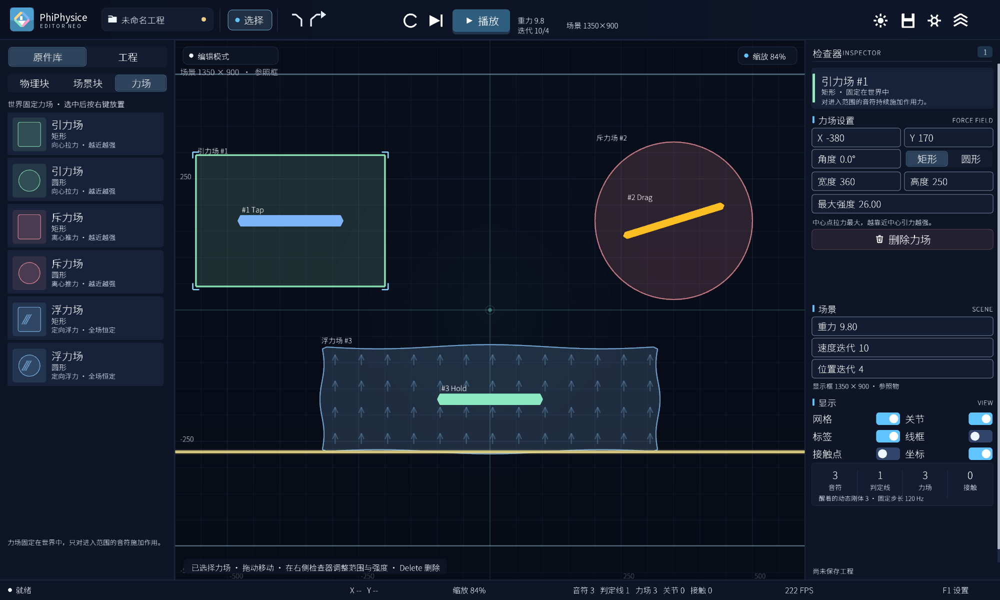

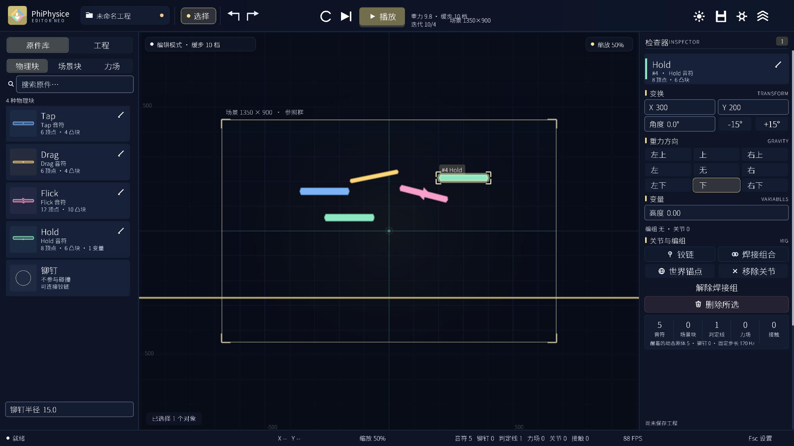

## 快速开始

### 系统要求

- Windows 10/11 x64 或 x86。
- 构建需要 Visual Studio（安装“使用 C++ 的桌面开发”工作负载）、CMake 和 Ninja。
- 运行发布包不需要安装任何运行库；压缩包内已包含所需的 VC++ 运行时 DLL。

### Windows

默认构建 x64：

```powershell
powershell -ExecutionPolicy Bypass -File .\scripts\build_windows.ps1
```

构建 x86：

```powershell
powershell -ExecutionPolicy Bypass -File .\scripts\build_windows.ps1 `
  -Arch x86 -BuildDir "build\x86" -NoCopyRoot
```

脚本会优先使用 `D:\tools\raylib-5.5_win64_msvc16` / `D:\tools\raylib-5.5_win32_msvc16`，也可以通过 `-RaylibRoot` 指定。工程路径包含中文时，脚本会用 `subst` 映射临时 ASCII 盘符；构建完成后运行 `--selftest`。

一次生成 x64 和 x86 两个发布压缩包：

```powershell
powershell -ExecutionPolicy Bypass -File .\scripts\package_windows.ps1
```

手动构建（x64）：

```powershell
cmake -S . -B build/x64 -G Ninja -DCMAKE_BUILD_TYPE=Release `
  -DRAYLIB_ROOT="D:/tools/raylib-5.5_win64_msvc16" `
  -DPHIPHYSICE_COPY_TO_ROOT=OFF
cmake --build build/x64
.\build\x64\PhiPhysiceEditorNeo.exe --selftest
```

手动构建 x86 时，需要在 32 位 MSVC 环境中运行同样的命令，并把 `RAYLIB_ROOT` 指向 `raylib-5.5_win32_msvc16`。`RAYLIB_ROOT` 不存在时，CMake 会通过 `FetchContent` 拉取 raylib 5.5 源码；也可以安装 raylib 让 `find_package(raylib)` 找到它。

### Linux

需要 C++20 编译器、CMake、Ninja 以及 raylib 所需的 X11/OpenGL 开发包，例如 Debian/Ubuntu：

```bash
sudo apt install build-essential cmake ninja-build libasound2-dev libx11-dev \
  libxrandr-dev libxi-dev libgl1-mesa-dev libglu1-mesa-dev libxcursor-dev \
  libxinerama-dev
bash scripts/build_unix.sh
./build/PhiPhysiceEditorNeo --selftest
```

### macOS

安装 Xcode Command Line Tools 和 CMake 后：

```bash
brew install cmake ninja
bash scripts/build_unix.sh
./build/PhiPhysiceEditorNeo --selftest
```

## 运行

- 发布包：解压后双击 `PhiPhysiceEditorNeo.exe`。
- 源码构建：运行 `build\x64\PhiPhysiceEditorNeo.exe`，或由构建脚本复制到根目录的 `PhiPhysiceEditorNeo.exe`。
- Linux/macOS：`./build/PhiPhysiceEditorNeo`。
- 同一用户会话只运行一个编辑器实例；再次启动会激活已有窗口，不会重复打开。
- 程序从可执行文件所在目录向上查找 `components/` 和 `assets/`，因此根目录和 `build/` 中的 exe 都能工作。
- 数据目录：`components/physics/`（物理块）、`components/scene/`（场景块）、`components/fields/`（力场）、`projects/`（工程）、`assets/fonts/`（字体）、`assets/icon.png`（窗口图标）、`settings.ini`（设置，首次修改设置时生成）、`export_rules.txt`（导出模板）。
- 第一次运行没有 `settings.ini` 时使用默认设置；修改设置或快捷键后自动写入程序目录。
- 示例工程见 `projects/Demo.pnp`。

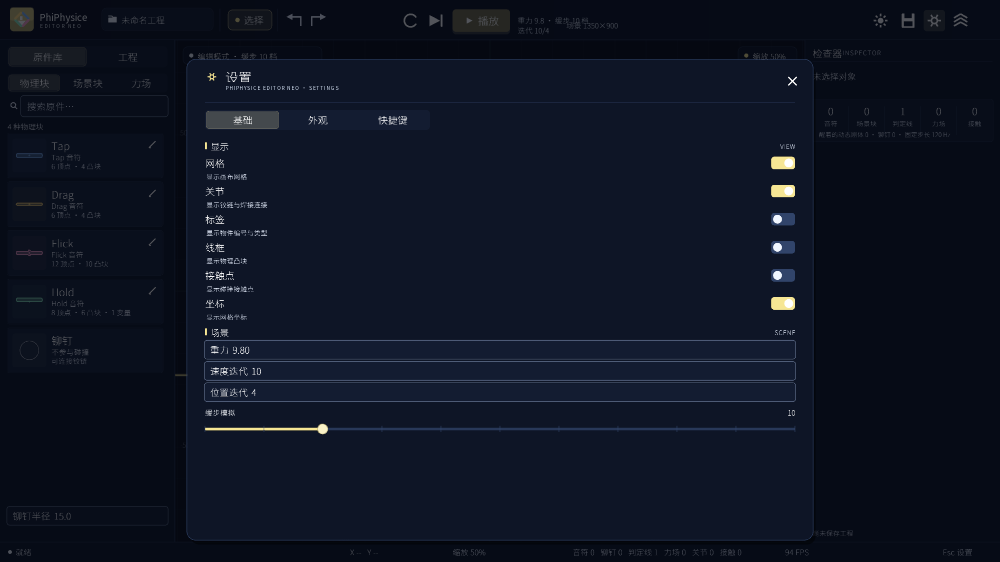

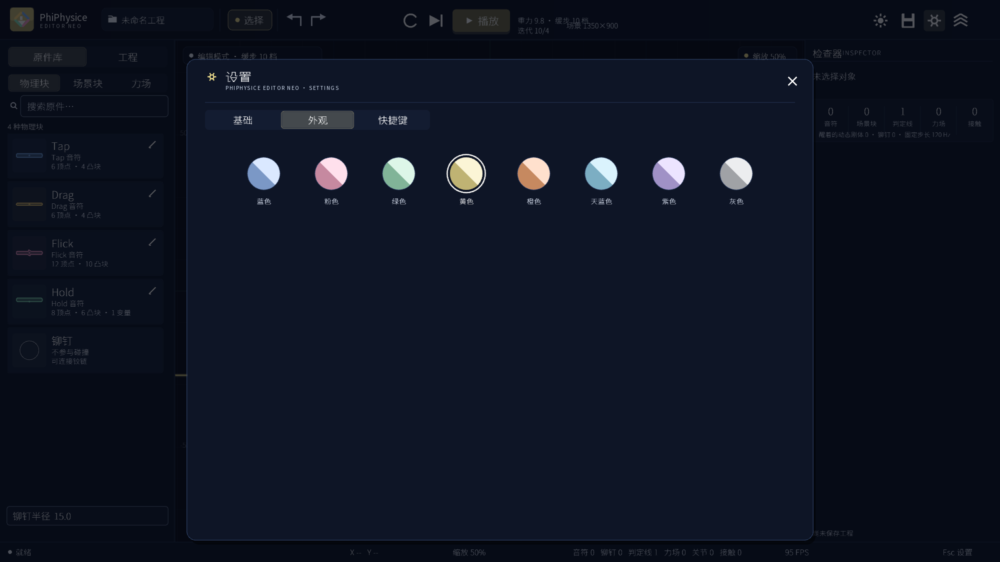

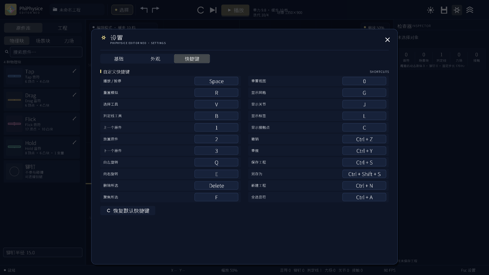

## 数据与文件格式

### `components/`：原件文件

`components/` 下分为三个文件夹：

- `physics/`：物理块（Tap、Drag、Flick、Hold、Rivet）
- `scene/`：场景块（Tap、Drag、Flick、Hold、Rivet、JudgeLine）
- `fields/`：力场（Gravity、Repulsion、Buoyancy、Drag、GravityChange、Vortex）

物理块和场景块的 `.note` 文件使用同一套节点格式。每个文件一个原件类型，名称、数量、每个顶点位置都是显式字段：

```text
# PhiPhysiceEditorNeo shape v2
yaxis up
name Hold
vertices 8
v -100 18
v -100 10
v -95 0
v 95 0
v 100 10
v 100 18
v 95 28
v -95 28
density 1.00
friction 0.6
restitution 0.04
color 140 232 194
&height 高度 = 0
$0 this this+height
$5 this this+height
$6 this this+height
$7 this this+height
```

- `name`：类型名称，同时决定文件名 `<name>.note`；物理块和场景块文件夹各自列出 Tap、Drag、Flick、Hold 四种类型。
- `&变量名 显示名 [= 默认值]`：声明一个类型变量；该值是类型的默认值，每个已放置音符都可以在检查器中单独覆盖。
- `$节点编号 X表达式 Y表达式`：用表达式**覆盖**该顶点的 X/Y 坐标；`this` 表示该顶点在文件中的默认坐标，需要偏移时写 `this + ...`。只写一个表达式时表示 Y 坐标。表达式支持变量名、常量 `pi`/`e`、`+ - * / % ^`、括号，以及 `abs/sqrt/sin/cos/tan/floor/ceil/round/min/max/clamp`。
- `yaxis up`：当前文件使用 Y-up 坐标；旧版 Y-down 文件在载入时只做内存转换，不回写文件。
- `vertices`：顶点数量，与后续 `v` 行数一致。
- `v x y`：顶点坐标，单位是设计像素（px），Y 向上为正。文件中的 (0,0) 就是音符原点，不会被自动移到质心；物理重心由轮廓面积质心单独计算。Hold 的默认原点在底部中心。顶点顺序可以为顺时针或逆时针，载入时统一为正向；重合节点会保留，不会自动合并。
- 变量表达式的结果**覆盖**节点坐标，不再叠加到原坐标上。
- 凹多边形可用，物理层自动三角化。
- 可选材质字段：`density`、`friction`、`restitution`、`color R G B`。
- 文件保存采用临时文件 + 重命名。

铆钉和判定线也使用类似的 `.note` 配置文件，例如 `physics/Rivet.note`、`scene/Rivet.note` 和 `scene/JudgeLine.note`：

```text
# PhiPhysiceEditorNeo component v1
kind rivet
name 铆钉
radius 15
color 172 178 190
```

```text
# PhiPhysiceEditorNeo component v1
kind judge
name 判定线
width 4000
height 5
color 255 238 150
```

力场文件示例：

```text
# PhiPhysiceEditorNeo field v1
kind 2
name 浮力场
shape 0
width 100
height 100
radius 50
strength 18
buoyancy 1.2
damping 0
vortex 0
dirx 0
diry 1
```

- `kind`：力场编号 0 引力 / 1 斥力 / 2 浮力 / 3 阻力 / 4 引力改变 / 5 涡流。
- `shape`：0 矩形 / 1 圆形；矩形使用 `width`/`height`，圆形使用 `radius`。
- `strength`、`buoyancy`、`damping`、`vortex`、`dirx`/`diry` 是放置新力场时的默认参数；`vortex` 为正数顺时针、负数逆时针。

### `projects/`：工程文件

工程文件是纯文本 `.pnp`，记录判定线、力场、音符实例、每个音符的变量与重力方向、铰链、焊接和初始布局，例如：

```text
PHIPHYSICE-PROJECT 17
name Demo
slowstep 10
eventsplit 4
nextids 7 6 4 2 2 4
[notes]
note 1 Tap -260.000 -300.000 0.000 0 1 0 15.000 172 178 190 0
note 2 Hold 300.000 200.000 0.000 0 1 0 15.000 172 178 190 0
[notevars]
notevar 2 height 150.000
[judges]
judge 1 0.000 -270.000 0.000 4000.000 5.000 255 238 150 0
[fields]
field 1 0 0 -380.000 170.000 0.000 360.000 250.000 180.000 26.000 0.000 1.000 1.200 4.000 0.000
field 2 2 1 0.000 -170.000 0.000 420.000 260.000 180.000 18.000 0.000 1.000 1.200 0.000 0.000
[rev]
rev 1 1 2 80.000 -25.000 -69.039 47.525 17.189 0 1
[weld]
weld 3 4 5 0.000 0.000 196.420 -387.710 56.000 0.000 244.161 -416.981 1
[end]
```

- 坐标单位为设计像素，Y 轴向上为正，角度在文件中使用度。
- 工程版本 3 起使用 Y-up；版本 4 增加 `[notevars]`；版本 5 在 `note` 行末增加每个音符的重力方向编号（0 上、1 下、2 左、3 右、4 左上、5 右上、6 左下、7 右下、8 无）；版本 6 增加 `[fields]` 力场段和 `nextids` 末尾的力场 id；版本 7 在 `note` 行末增加场景块标记；版本 8 增加力场阻尼和阻力/引力改变两种力场；版本 9 增加 `slowstep` 缓步开关；版本 10 把 `slowstep` 改为 0–50 挡位，并为每个 `note` 行增加铆钉半径和颜色；版本 11 增加 `[events]` 事件时间轴；版本 12/13 调整角度约定；版本 14 增加重力方向事件类型；版本 15 增加方位/旋转动量事件和瞬时完成开关；版本 16 在 `note` 和 `judge` 行末增加虚化状态，并增加虚化事件类型；版本 17 增加有符号的涡流场强度与“涡流强度”事件。
- `note` 存储音符类型名称、位置、旋转、焊接组编号、重力方向、场景块标记、铆钉半径 / 颜色（普通音符忽略半径和颜色），版本 16 起末尾增加虚化状态。
- `[notevars]` 段保存每个音符的变量值：`notevar <id> <name> <value>`；没有覆盖时使用类型默认值。
- `[judges]` 存储判定线：`judge <id> <x> <y> <angleDeg> <width> <height> <r> <g> <b> [ghost]`（版本 16 起末尾增加虚化状态）；旧版工程中的 `[floors]` 静态平台会转换为判定线。
- `[fields]` 存储力场：`kind` 0 引力 / 1 斥力 / 2 浮力 / 3 阻力 / 4 引力改变 / 5 涡流；`shape` 0 矩形 / 1 圆形；矩形使用 `width`/`height`，圆形使用 `radius`；`strength` 为引力/斥力中心最大加速度（阻力场中为阻力系数），`dirX dirY` 为引力改变方向，`buoyancy` 在浮力场中表示流体密度（`F = 密度 × 排水面积 × 重力`），`damping` 为引力场阻尼，版本 17 起末尾的 `vortex` 为涡流场切向强度（正数顺时针、负数逆时针）。版本 10 起不再写入已删除的拟真浮力和浮力底部阻力字段；旧工程载入时会自动读取并迁移。
- 旧版工程里引用已删除类型的音符会在载入时跳过，相关关节一并丢弃。
- `rev` 存储铰链两端音符 id（`-1` 表示世界）、两个局部锚点和参考角。
- `weld` 使用两个局部锚点约束相对位置与旋转。
- **旧版兼容**：1.0 更名为 PhiPhysiceEditorNeo 后，程序仍能读取旧版 `POLYNOTE-PROJECT` / `POLYNOTE-SETTINGS` 文件头，以及旧版 `# PolyNote shape`、`# PolyNote component`、`# PolyNote field` 注释头；保存时统一写入新名称。旧工程不需要手工转换。
- 详细语法见 [docs/FORMAT.md](docs/FORMAT.md)。

### `settings.ini`：程序设置

```text
PHIPHYSICE-SETTINGS 1
light 0
accent 0
show_grid 1
show_joints 1
show_labels 1
show_wireframe 0
show_contacts 0
show_grid_labels 1
gravity 9.8
velocity_iterations 10
position_iterations 4
slow_step_gear 10
bpm 180
rivet_radius 15
export_directory D:/exports
[shortcuts]
play_pause 32 0 0
undo 90 1 0
...
```

- `light` 保存上次使用的日间/夜间模式（0 夜间、1 日间）。
- `accent` 保存主题色编号（0–7：蓝、粉、绿、黄、橙、天蓝、紫、灰）。
- `show_*` 保存设置“基础”页中的全部显示开关，启动时恢复。
- `gravity` / `velocity_iterations` / `position_iterations` / `slow_step_gear` 保存“基础”页的场景参数与缓步挡位。
- `bpm` 保存设置“基础”页的 BPM（默认 180）。
- `rivet_radius` 保存原件库底部的全局铆钉半径。
- `export_directory` 保存预制事件的输出目录；留空时使用程序目录下的 `exports`。
- `[shortcuts]` 以 `按键码 Ctrl Shift` 保存重新绑定后的快捷键。
- 旧版 `POLYNOTE-SETTINGS 1` 文件可以直接读取，首次保存后自动写成 `PHIPHYSICE-SETTINGS 1`。

## 界面与快捷键

- **左栏**：原件库 / 工程列表；原件库内含物理块、场景块、力场三个分区，顶部搜索框对所有分区生效。点击原件卡片进入放置模式，点击原件卡片右侧铅笔编辑对应 `components/` 文件；底部的“铆钉半径”对所有铆钉生效。
- **中栏**：画布；鼠标未进入音符时中键/右键拖动平移，进入音符后右键拖动铰链端点；滚轮缩放；按 `2` 放置；1350 × 900 参照框标出场景范围。放置时预览颜色跟随音符或铆钉颜色，并在鼠标上方显示切换/放置快捷键。
- **右栏**：检查器；调整位置、旋转、重力方向、变量值、铆钉颜色、虚化状态、判定线尺寸和力场参数，并为选中音符创建铰链/焊接/世界锚点；多选音符时还可以批量切换虚化。重力、速度迭代、位置迭代、缓步模拟和显示开关位于设置的“基础”页，铆钉半径位于原件库底部。
- **底栏**：鼠标坐标、缩放、对象统计、FPS 和提示。
- **右上角**：日间/夜间切换、保存、设置、工程列表。

默认快捷键（可在设置的“快捷键”页重新绑定）：

| 快捷键 | 功能 |
| --- | --- |
| `Space` | 播放 / 暂停 |
| `R` | 重置到编辑布局 |
| `V` / `B` | 选择工具 / 场景块判定线放置 |
| `Q` / `E` | 旋转所选对象 |
| `Delete` | 删除所选 |
| `F` | 聚焦所选（无选择时聚焦全场景） |
| `0` | 重置视图 |
| `G` / `J` / `L` / `C` | 网格 / 关节 / 标签 / 接触点（自动保存） |
| `Ctrl+Z` / `Ctrl+Y` | 撤销 / 重做 |
| `Ctrl+S` / `Ctrl+Shift+S` | 保存 / 另存为 |
| `Ctrl+N` | 新建工程 |
| `Ctrl+A` | 选择全部音符 |
| `1` / `2` / `3` | 在当前分区切换上一个 / 放置 / 下一个原件（可自定义） |
| `Esc` | 退出放置模式 → 取消选中 → 空闲时打开设置 / 关闭弹窗 |
| `W` / `A` / `S` / `D` | 移动选中对象坐标 |

**编辑提示**：任何编辑操作都会自动暂停模拟；如果当前处于模拟中途，编辑前会先回到编辑布局。

## 项目结构

```text
PhiPhysiceEditorNeo/
├─ CMakeLists.txt
├─ LICENSE / THIRD_PARTY_NOTICES.md
├─ README.md
├─ src/
│  ├─ core/          数学、向量、路径工具
│  ├─ physics/       自研 2D 刚体引擎（碰撞、求解、关节）
│  ├─ model/         音符类型库、文档模型、撤销、缓动
│  ├─ io/            .note / .pnp 文件读写与应用内工程列表
│  ├─ app/           应用状态、设置、模拟世界同步、输入与自检
│  └─ ui/            主题、控件、画布、检查器、形状编辑器、设置与弹窗
├─ components/       原件文件（physics / scene / fields）
├─ projects/         示例工程（Demo.pnp）
├─ assets/           字体、字体许可、程序图标
├─ docs/             格式文档、截图、第三方许可
├─ scripts/          Windows / Unix 构建与打包脚本
├─ tools/            图标生成脚本
└─ dist/             构建出的发布压缩包（不提交到 Git）
```

## 自研物理引擎

- **形状**：音符轮廓归一化为正向多边形并保留文件原点，耳切三角化得到凸块；构建刚体时把轮廓平移到面积质心，再累加质量、质心与转动惯量，因此原点（尤其 Hold 的底部原点）和重心互不影响。
- **凸形碰撞**：凸多边形轮廓作为整体参与 SAT，接触流形最多两个接触点，避免三角剖分内部边产生额外法线。
- **凹形碰撞**：凸块之间检测后，用真实轮廓过滤内部边接触，并按位置去重，降低堆叠和静止时的抖动。
- **宽相**：按 AABB 左边界排序的扫掠 + 重叠判断。
- **窄相**：多边形 SAT 选参考边，裁剪入射边生成 1–2 个接触点；接触点转成局部锚点用于稳定求解。
- **求解**：顺序冲量，法向/切向累积冲量，Baumgarte 偏置 + 位置修正，热启动，睡眠。
- **重力**：场景重力提供大小，每个音符可选择独立方向，选择“无”时加速度为零。
- **关节**：铰链（2×2 点约束）、焊接（同一对刚体上的两个点约束）和世界锚点（A 端为空的世界约束）。
- **碰撞过滤**：负 group 阻止同一铰链链/焊接组内部互撞。

## 测试与截图

```powershell
.\build\x64\PhiPhysiceEditorNeo.exe --selftest
```

自检不创建窗口，覆盖多边形、物理、变量、文件格式、每个音符的重力、设置读写等检查。渲染验证可使用：

```powershell
.\build\x64\PhiPhysiceEditorNeo.exe --screenshot docs/screenshots/main.png --frames 10
.\build\x64\PhiPhysiceEditorNeo.exe --screenshot docs/screenshots/settings.png --settings --frames 10
.\build\x64\PhiPhysiceEditorNeo.exe --screenshot docs/screenshots/settings-shortcuts.png --settings-shortcuts --frames 10
.\build\x64\PhiPhysiceEditorNeo.exe --screenshot docs/screenshots/settings-appearance.png --settings-appearance --frames 10
.\build\x64\PhiPhysiceEditorNeo.exe --screenshot docs/screenshots/judge-line.png --judge-selected --frames 10
.\build\x64\PhiPhysiceEditorNeo.exe --screenshot docs/screenshots/notes.png --demo --frames 10
.\build\x64\PhiPhysiceEditorNeo.exe --screenshot docs/screenshots/shape-editor.png --shape --frames 10
.\build\x64\PhiPhysiceEditorNeo.exe --screenshot docs/screenshots/light.png --light --frames 10
.\build\x64\PhiPhysiceEditorNeo.exe --screenshot docs/screenshots/fields.png --fields --frames 10
.\build\x64\PhiPhysiceEditorNeo.exe --screenshot docs/screenshots/judge-preview.png --judge-place --frames 10
.\build\x64\PhiPhysiceEditorNeo.exe --screenshot docs/screenshots/scene-blocks.png --scenes --frames 10
```

## 已知边界

- 音符类型名和工程名使用 ASCII，便于跨平台文件系统；界面文字是中文。
- 工程保存编辑布局，模拟过程中的瞬时位置在重置后回到布局。
- 缓步模拟每帧按挡位拆分子步；音符和力场特别多时物理开销随挡位线性增加。
- 工程引用不存在的音符类型时不会崩溃；画布显示缺失类型警告，物理侧跳过该音符。
- 字体图集按需生成，增加界面中文文案后不需要再运行字形烘焙脚本；旧版的生成文件已从 1.0 仓库移除。
- 修改程序图标后重新生成图标资源（需要 Python 与 Pillow）：

```bash
python tools/generate_icon.py
```

- 界面字体是 Noto Sans SC 的 OFL 衍生版本（Regular 静态实例），不是系统字体；发布包必须同时保留 `assets/fonts/LICENSE-OFL.txt` 和 `assets/fonts/NOTICE.md`，否则不满足 OFL 的分发条件。
- Windows 可执行文件未使用商业代码签名证书；版本资源已将作者/发布者标记为 `Abnormalily`，并通过 asInvoker 清单避免自动提权引起的“无法验证发布者”提示。如果从网络下载后仍被 SmartScreen 拦截，需要在系统“属性 → 数字签名”或浏览器信任设置中放行。

## 作者

- 作者 / 发布者：**Abnormalily**

## 发布与仓库

- 1.0 发布说明：[docs/RELEASE_NOTES_v1.0.0.md](docs/RELEASE_NOTES_v1.0.0.md)
- 一键打包命令：`powershell -ExecutionPolicy Bypass -File .\scripts\package_windows.ps1`
- 构建产物、运行设置、导出结果和压缩包都在 `.gitignore` 中排除，仓库只保留源码、数据、文档和资源。

## 字体与许可

- **代码**：MIT，见 [LICENSE](LICENSE)。
- **界面字体**：PhiPhysice Neo Sans Regular，是 [Noto Sans SC](https://notofonts.github.io/) 2.004 的 Regular 静态实例，按 **SIL Open Font License 1.1** 分发。原版权为 `Copyright 2014-2021 Adobe, with Reserved Font Name 'Source'`；本项目已重命名字体族，完整说明见 [assets/fonts/NOTICE.md](assets/fonts/NOTICE.md)，许可全文见 [assets/fonts/LICENSE-OFL.txt](assets/fonts/LICENSE-OFL.txt)。
- **第三方组件**：raylib、GLFW、glad、stb、miniaudio、dr_libs、cgltf、dirent、Microsoft VC++ 运行库等，见 [THIRD_PARTY_NOTICES.md](THIRD_PARTY_NOTICES.md) 与 `docs/licenses/`。
- **字体合规要点**：OFL 允许随软件分发和修改，但要求保留版权声明与许可文本、修改版不得使用原保留字体名、字体不得单独出售。本项目保留了完整 OFL 文本并重命名字体族，发布包中请勿删除 `assets/fonts/` 下的许可与说明文件。
- **不包含**：商业字体、系统字体副本、Adobe/Google 品牌素材、Box2D、Dear ImGui 或其他无法确认授权的第三方源码。
- 程序图标、界面截图和示例工程由本项目生成，可随项目一起分发。
- 本文不构成法律意见；如需商业发行，请根据所在司法辖区自行复核第三方许可。
